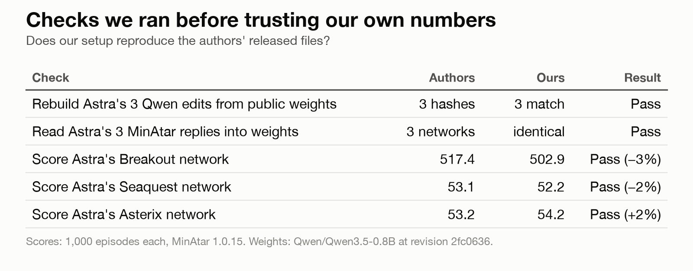
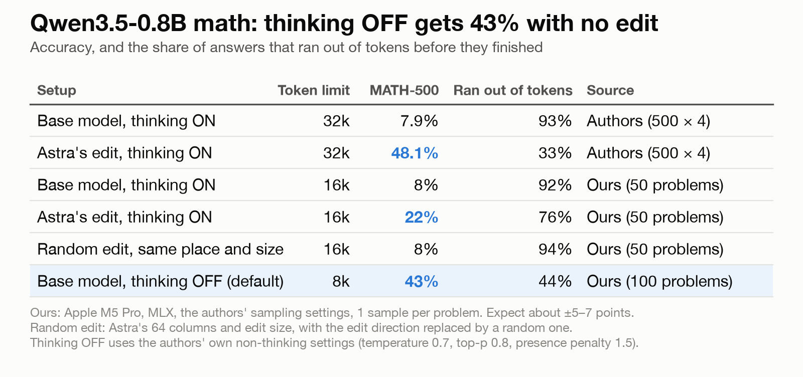
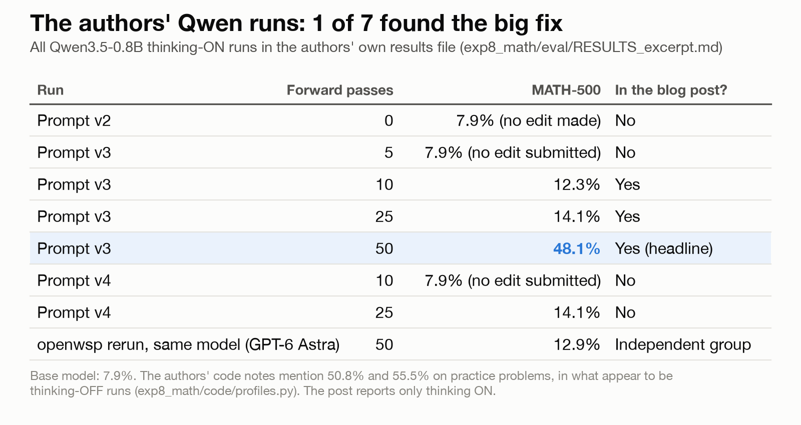
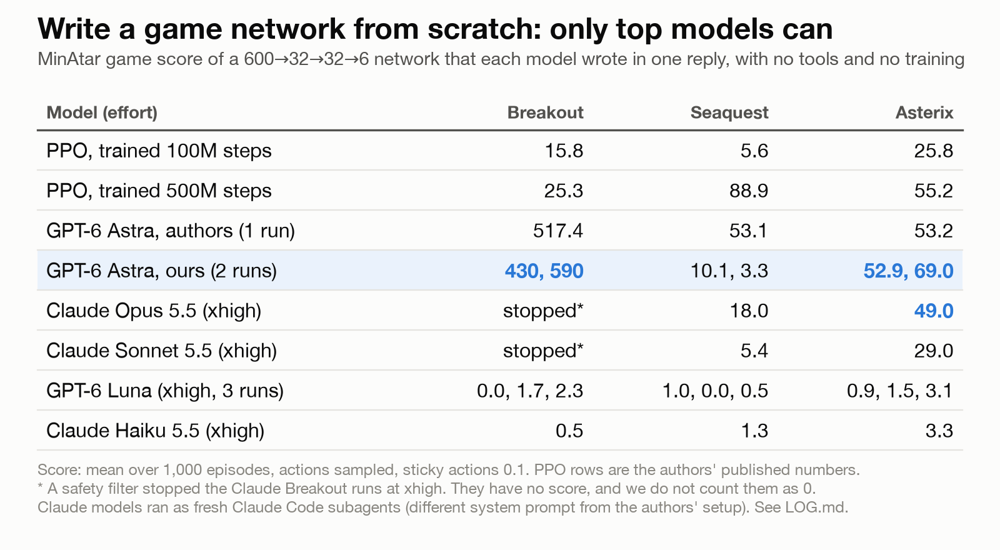

# Conclusion: we tried to repeat "Sparks of Weight-Space Programming"

This document explains what we did, why we did it, and what we found. It reads from start to finish. The full
record of every run is in `LOG.md`.

## 1. The claim we tested

In November 2026, a team at MIT published a blog post called "Sparks of Weight-Space Programming". The post says
that a large language model can read and change the numbers inside another neural network. These numbers are
called "weights". The model changes them directly, with no training.

The post used one model, OpenAI's GPT-6 Astra. Two results got the most attention:

1. Astra changed 0.016% of the weights of a small language model, Qwen3.5-0.8B. Its score on a math test
   (MATH-500) went from 7.9% to 48.1%.
2. Astra wrote small game-playing networks from zero, in one reply. The networks beat a standard training method
   (PPO) that had 100 million steps of practice.

These results seemed too good to be true. We wanted to know three things:

- Do the numbers repeat on our own machine?
- Do the gains hold up against fair comparisons?
- Can smaller and cheaper models do the same thing?

## 2. What we used

- **Computer:** one Apple laptop (M5 Pro, 48 GB memory). It has no NVIDIA graphics card, so we used Apple's MLX
  library to run the models. The authors used vLLM on NVIDIA cards.
- **The authors' files:** the authors published their prompts, the replies, the networks and their scores. They did
  not publish the program that ran the experiments. We wrote our own.
- **Models we tested as editors:** GPT-6 Astra and GPT-6 Luna through a ChatGPT subscription. Claude Opus 5.5,
  Sonnet 5.5 and Haiku 5.5 through Claude Code.
- **Time:** about one working day. A short time limit forced us to cut some runs (see section 7).

Other groups also started to repeat this work in the same week. We read their reports and we name them in
section 8. We did not run their code.

## 3. First, we checked our own setup

A test is only useful if it measures the same thing as the original. Before we trusted any new number, we checked
that our setup reproduced the authors' published files.

| Check | Authors | Ours | Result |
|---|---|---|---|
| Rebuild Astra's 3 Qwen edits from the public model weights | 3 file fingerprints | 3 match | Pass |
| Read Astra's 3 game replies into network weights | 3 networks | identical | Pass |
| Score Astra's Breakout network | 517.4 | 502.9 | Pass (−3%) |
| Score Astra's Seaquest network | 53.1 | 52.2 | Pass (−2%) |
| Score Astra's Asterix network | 53.2 | 54.2 | Pass (+2%) |

All checks passed. The small score differences come from random chance in the games.

## 4. Experiment A: Does the math edit work?

### 4.1 What the edit does

Qwen3.5-0.8B has a "thinking" mode. In this mode, the model writes its reasoning before it gives an answer. With
thinking on, this small model often gets stuck. It repeats the same reasoning again and again until it reaches
its word limit. The model then never gives an answer.

Astra found the part of the network that causes this repetition. It removed that part with a small change to two
layers. After the change, the model finishes more answers, and more of its answers are correct.

### 4.2 Our test

We ran the original model and Astra's edited model on the same math problems with the same settings. We also
added two comparisons that the post does not include:

1. **A random edit.** We made a change of the same size, in the same place, in a random direction. If this random
   change also helps, then any disturbance helps, and Astra's choice does not matter.
2. **Thinking off.** The model card says that this model runs with thinking off by default. We tested the
   unedited model in that mode.

| Setup | Word limit (tokens) | MATH-500 score | Answers that ran out of words | Source |
|---|---|---|---|---|
| Original model, thinking on | 32k | 7.9% | 93% | Authors |
| Astra's edit, thinking on | 32k | 48.1% | 33% | Authors |
| Original model, thinking on | 16k | 8% | 92% | Ours (50 problems) |
| Astra's edit, thinking on | 16k | 22% | 76% | Ours (50 problems) |
| Random edit, same place and size | 16k | 8% | 94% | Ours (50 problems) |
| Original model, thinking off | 8k | 43% | 44% | Ours (100 problems) |

### 4.3 What this shows

- **Astra's edit is real and specific.** It fixed 8 problems and broke 1. The random edit fixed 3 and broke 3.
  So Astra found a real cause of the repetition.
- **The word limit matters a lot.** At 16k tokens, the edited model scored 22%. Most of its answers still ran out
  of words. The authors used a 32k limit and got 48.1%. Another group (tdotlab) also saw scores rise when they
  doubled the limit.
- **The original model with thinking off scored 43%.** It needed no edit. This is close to the 48.1% headline.
- **The authors knew about this.** A comment in their own code says that the model loops with thinking on, and
  that the model card makes thinking off the default. Their code notes also mention scores of 50.8% and 55.5% for
  the unedited model on practice problems, in runs that appear to use thinking off. The post reports only the thinking-on results.

So a fair summary is: the edit repairs a broken mode of the model and makes it about as good as its normal mode.
"7.9% to 48.1%" compares against the broken mode only.

### 4.4 The authors' other runs

The authors also published a results file that lists every Qwen run. The blog post shows three of them.

| Run | Forward passes (test runs allowed) | MATH-500 | In the blog post? |
|---|---|---|---|
| Prompt v2 | 0 | 7.9% (no edit made) | No |
| Prompt v3 | 5 | 7.9% (no edit submitted) | No |
| Prompt v3 | 10 | 12.3% | Yes |
| Prompt v3 | 25 | 14.1% | Yes |
| Prompt v3 | 50 | 48.1% | Yes (headline) |
| Prompt v4 | 10 | 7.9% (no edit submitted) | No |
| Prompt v4 | 25 | 14.1% | No |
| openwsp group, same setup, GPT-6 Astra | 50 | 12.9% | Independent repeat |

One run out of about seven found the large fix. An independent group (openwsp) ran the same setup with GPT-6
Astra and got 12.9%. So the large result is possible, but it does not happen reliably.

## 5. Experiment B: Can a model write a network from zero?

### 5.1 The task

Each model received the rules and the source code of a small video game (from the MinAtar collection). It also
received the shape of a small network: 600 inputs, two layers of 32 units, and 6 outputs. All weights started at
zero. The model had to write every weight in one reply. It had no tools, no calculator, and no way to test the
network. We then scored the network over 1,000 games.

### 5.2 Results

| Model (effort) | Breakout | Seaquest | Asterix |
|---|---|---|---|
| PPO, trained 100 million steps | 15.8 | 5.6 | 25.8 |
| PPO, trained 500 million steps | 25.3 | 88.9 | 55.2 |
| GPT-6 Astra, authors (1 run) | 517.4 | 53.1 | 53.2 |
| GPT-6 Astra, ours (2 runs) | 430, 590 | 10.1, 3.3 | 52.9, 69.0 |
| Claude Opus 5.5 (xhigh) | stopped* | 18.0 | 49.0 |
| Claude Sonnet 5.5 (xhigh) | stopped* | 5.4 | 29.0 |
| GPT-6 Luna (xhigh, 3 runs) | 0.0, 1.7, 2.3 | 1.0, 0.0, 0.5 | 0.9, 1.5, 3.1 |
| Claude Haiku 5.5 (xhigh) | 0.5 | 1.3 | 3.3 |

\* A safety filter stopped both Claude Breakout runs at xhigh effort. These runs have no score. We do not count
them as zero.

"Effort" sets how long a model may think before it answers. "xhigh" is the setting the authors used.

### 5.3 What this shows

- **Astra repeats its Breakout and Asterix results.** Its Breakout networks score far above PPO.
- **Astra's Seaquest result did not repeat.** We got 10.1 and 3.3. The authors got 53.1. Another group (the Alan
  Turing Institute) got a mean of 25.5 over three runs. The published Seaquest run was probably a lucky one.
- **Opus is the only Claude model that wrote working networks.** It scored 49.0 on Asterix, close to Astra.
- **The smaller models failed.** Luna and Haiku scored near zero on every game. Their replies were complete and
  correctly formatted. The networks simply did not play well.
- **More thinking did not close the gap.** Sonnet used about 190,000 to 207,000 output tokens for each network.
  Astra used about 20,000 to 29,000. Sonnet still scored much lower.

So this ability is real, but only the strongest current models have it. It does not hold for smaller models.

## 6. Overall answer

| Question | Answer |
|---|---|
| Do the authors' published files reproduce? | Yes. All our checks passed. |
| Is the math edit real? | Yes. A random edit of the same size does nothing. |
| Is "7.9% to 48.1%" a fair summary? | No. The original model scores about 43% with thinking off, and only 1 of about 7 runs found the large fix. |
| Can a model write a working network from zero? | Yes, for GPT-6 Astra and partly for Claude Opus 5.5. |
| Does that hold for smaller models? | No. GPT-6 Luna, Claude Haiku and mostly Claude Sonnet failed. |

The core idea holds up: a strong language model can read a network, find a cause of a failure, and fix it by hand.
The headline numbers make the result look larger than it is.

## 7. Limits of this work

- **Small samples.** Most of our numbers come from 1 to 3 runs, and our math tests use 50 or 100 problems with one
  answer each. Expect each math score to move by about 5 to 7 points if you run it again.
- **Different software.** We used MLX on an Apple laptop. The authors used vLLM on NVIDIA cards. Small number
  differences are normal between the two.
- **Shorter word limit.** We ran the math tests at 16k tokens, and the authors used 32k. We cut this because of
  time. Our 32k runs did not finish.
- **A software crash.** Long math runs hit a memory limit in MLX ("Resource limit exceeded"). We lost about two hours
  of runs before we found it. Our final runs restart after a crash and keep their earlier answers. No answers were
  lost in the final results.
- **Claude ran in a different setup.** The Claude account for headless use was not available. We ran each Claude
  model as a fresh Claude Code helper agent that had no knowledge of our work. It read the task from a file and
  wrote its answer to a file. It used no other tools, and we checked every log to confirm this. Its system prompt
  was different from the authors' one-line prompt.
- **Safety filter.** A safety filter stopped two Claude Breakout runs. We did not retry them or change the prompt.
- **Runs we did not do:** 11 more random-edit tests, the full 32k comparison, and more runs for each model. The
  scripts for these runs are in the repository (`runs/queue3.sh`).

## 8. Related work

These groups also repeated parts of the paper in the same week. We read their results but did not run their code.

- **Alan Turing Institute** (`alan-turing-institute/weights_editing`): game and network-reading tests, with
  extra controls.
- **MatinKhajavi** (`MatinKhajavi/Weight-Space-Programming`): all 8 experiments with Claude Opus 5.5.
- **openwsp** (`openwsp/openwsp`): a full repeat of the math experiment with GPT-6 Astra.
- **tdotlab** (`tdotlab/weight-space-programming`): math edits by hand on Qwen3.5-0.8B and 2B.

## 9. How to repeat our work

The steps are in `README.md`. The full record of every run, every setting and every problem we hit is in `LOG.md`.
